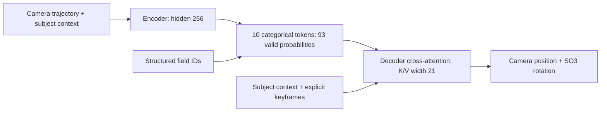

# LensCraft

LensCraft generates and edits camera trajectories through one categorical
semantic bottleneck. This is the project's only generator architecture;
there is no CLIP-conditioned, merged-memory or learned-ID generator mode.

The encoder returns ten categorical distributions as `[10, batch, 21]`:
**93 valid probabilities**, 117 fixed zero padding coordinates and 83 continuous
degrees of freedom. A known annotation supplies one one-hot target per field.
An unknown field is zero and excluded from attention. The field sizes are
`[5, 8, 8, 13, 21, 4, 5, 8, 8, 13]`; movement includes `nativePan` and
`nativeOrbit`.

The default model has **6,907,937 parameters**, hidden width 256, eight heads,
four encoder and four decoder layers, and feedforward width 1024. The decoder
cross-attends directly to the 21D tokens. Fixed field codes identify their
positions only during attention. There is no embedding table, latent merger,
external memory projection or hidden encoder-state path into the decoder.
Subject trajectory and volume remain context; explicit keyframes remain pose
constraints. Camera output uses position3 and an SVD9D rotation projected to SO(3).

Training uses per-field cross-entropy with weight 1, detached-target
`KL(original || cycle)` with weight 1, and the configured camera geometry losses.
Only known categorical labels enter CE and KL. Generator training and inference
do not load CLIP. Frozen semantic/CLaTr judges and external ET, CCDM and GenDoP
baselines remain separate evaluation dependencies.



See the [categorical representation](docs/categorical_conditioning.md),
[training recipes](docs/training_and_evaluation.md), and
[fixed evaluation contract](docs/evaluation.md).

**Checkpoint compatibility:** the current categorical checkpoint state keys
are preserved. Saved categorical configs are migrated by the loader. Older
512D CLIP/merged generator checkpoints are rejected explicitly; use their
frozen historical source outside this project to reproduce those experiments.

## Installation

1. Clone the repository **with submodules** (DIRECTOR, Camera-control and GenDoP live in `third_parties/`):
   ```bash
   git clone --recurse-submodules https://github.com/ZahraDehghanian97/LensCraft.git
   cd LensCraft
   # or, if already cloned:
   git submodule update --init --recursive
   ```

2. Create a virtual environment (optional but recommended):
   ```bash
   python -m venv venv
   source venv/bin/activate  # On Windows, use `venv\Scripts\activate`
   ```

3. Install the required packages:
   ```bash
   pip install -r requirements.txt
   ```
   > **Note:** `requirements.txt` pins `optuna==4.3.0`, which conflicts with the
   > dependency metadata of `hydra-optuna-sweeper==1.2.0` (it declares `optuna<3.0.0`).
   > If pip reports `ResolutionImpossible`, install the sweeper separately:
   > ```bash
   > grep -v '^hydra-optuna-sweeper' requirements.txt | pip install -r /dev/stdin
   > pip install --no-deps hydra-optuna-sweeper==1.2.0
   > ```

   Alternatively, to reproduce the exact known-good environment for
   pre-Blackwell GPUs (`torch==2.4.1+cu124`), install the full
   `pip freeze` snapshot of the RTX 4000 machine:
   ```bash
   pip install --no-deps -r pip-freeze-rtx4000.txt
   ```
   > **Note:** the `--no-deps` flag is required. The snapshot contains the
   > same `optuna` / `hydra-optuna-sweeper` pair as above, so a plain
   > `pip install -r pip-freeze-rtx4000.txt` fails with `ResolutionImpossible`
   > even though the combination works in practice. Skipping resolution is
   > safe here because a freeze file already pins every transitive dependency.
   > This snapshot also includes the GenDoP extras listed below.

## Datasets

The project supports three datasets, selected at runtime via Hydra
(`config/data/dataset/{default,et,ccdm,multi}.yaml`). Paths are resolved from
environment variables (see [Configuration](#configuration)).

### Simulation (default)

Synthetic camera-trajectory simulations stored as msgpack files. Each simulation
includes camera frames, subject information (position, size, rotation), and
instructions (camera movement, easing, initial camera angle, initial shot type).
`data/simulation/dataset.py` handles loading and preprocessing.

Download (full dataset, or the smaller `-mini` variant for quick experiments):
```bash
pip install gdown
# full dataset
gdown 1VT2XfBj9LFWLUBjv65dzC4bVzH0zdNDU
# mini variant (sim-data.tar.zst, extracts to simulation-data-4-mini/)
gdown 1xxIPzvjTUuUOoVEZjhNeRDRluhbHNUq8
zstd -dc sim-data.tar.zst | tar -xf -
```
Point `SIMULATION_DATA_PATH` at the extracted directory.

### E.T. (Exceptional Trajectories)

Download the pre-processed archive from Google Drive (`et-data.tar.zst`). In
this version the inner tar files are already extracted, so you only need to
unpack the archive once — no `untar_and_move.sh` step required:
```bash
gdown 1hX3ecFC1R9dFplDkjn1B_apS_f9llt7E
zstd -dc et-data.tar.zst | tar -xf -
```
This produces an `et-data/` directory. Set `ET_DATA_DIR` to it and
`DIRECTOR_PROJECT_DIR` to `third_parties/DIRECTOR`. If you extract as root
(e.g. in a container) and tar fails with `Cannot change ownership`, extraction
still succeeds — or pass `--no-same-owner` to tar.

> The archive was created with:
> ```bash
> tar -I 'zstd -3 -T0' -cf et-data.tar.zst -C /path/to/parent et-data
> ```

The cinematography instruction annotations for E.T. prompts are a separate
download:
```bash
gdown 1ZmC6EAcIcvdni6O1X8xpy1g1n_NRFtoR  # et_cinematography_instructions.json
```
Set `ET_CIN_LANG_PATH` to the downloaded JSON file.

### CCDM

Download and extract the CCDM data archive:
```bash
gdown 1Dazg2XMMmMmHl-dTe_7cf6RlDGHNqlN-  # ccdm-data.tar.zst
zstd -dc ccdm-data.tar.zst | tar -xf -
```
This produces a `ccdm/` directory containing `data.npy` and `Mean_Std.npy`;
set `CCDM_DATA_DIR` to it (the loader expects `$CCDM_DATA_DIR/data.npy`).
For evaluation against the pretrained CCDM model, place its checkpoint under
`third_parties/Camera-control/[2024][EG]Text+keyframe/` and set
`CCDM_CHECKPOINT_PATH`.

## GenDoP baseline

To run inference/evaluation against the pretrained
[GenDoP](https://github.com/3DTopia/GenDoP) model (`training/model=gendop`):

1. Install its extra dependencies (kept out of `requirements.txt` since they
   are only needed for this baseline; already present if you installed
   `pip-freeze-rtx4000.txt`):
   ```bash
   pip install diffusers==0.34.0 accelerate kiui tyro trimesh megfile
   ```
   > `diffusers>=0.35` is incompatible with `torch==2.4.1` (the version
   > pinned in `pip-freeze-rtx4000.txt`)
   > (its attention-op registration fails at import). `flash-attn` is
   > optional — GenDoP falls back to a naive attention implementation
   > (you will see a `[WARN] flash_attn not available` print, which is fine
   > for inference).

2. Download the released `text_motion` checkpoint (~2.1 GB) and set
   `GENDOP_CHECKPOINT_PATH`:
   ```bash
   mkdir -p third_parties/GenDoP/checkpoints
   wget "https://huggingface.co/Dubhe-zmc/GenDoP/resolve/main/checkpoints/text_motion.safetensors" \
     -O third_parties/GenDoP/checkpoints/text_motion.safetensors
   ```

3. Build the local Stable Diffusion cache. GenDoP hardcodes
   `StableDiffusionPipeline.from_pretrained('stabilityai/stable-diffusion-2-1-base')`
   for its text encoder, but the official Stability AI repos are no longer
   publicly downloadable from the HuggingFace Hub (they return 401). Run once:
   ```bash
   python scripts/setup_gendop_sd_cache.py
   ```
   This assembles an equivalent cache entry (respecting `HF_HOME`): configs,
   tokenizer, scheduler and VAE come from the `sd2-community` mirror
   (~340 MB), the text-encoder weights are extracted from the GenDoP
   checkpoint itself, and the UNet — which GenDoP discards — is replaced by a
   tiny stand-in, avoiding its ~3.5 GB download.

Then run, e.g.:
```bash
python src/inference.py training/model=gendop data.batch_size=4
```

Notes:
- A CUDA GPU is required (the adapter loads the model in fp16 and generates
  under `torch.autocast`).
- GenDoP generates one prompt at a time, so keep `data.batch_size` small —
  expect it to be much slower than the LensCraft path.
- Metric evaluation via `src/test.py` additionally needs `ref_model` pointing
  at a separately frozen semantic judge and a CLaTr backend.

## Configuration

Runtime configuration is managed by [Hydra](https://hydra.cc/) (`config/`), and
dataset/output paths are read from a `.env` file in the project root
(`.env-sample` is a template you can copy):

```bash
HYDRA_FULL_ERROR=1

SIMULATION_DATA_PATH=/path/to/data/simulation-data
DIRECTOR_PROJECT_DIR=/path/to/LensCraft/third_parties/DIRECTOR
ET_DATA_DIR=/path/to/data/et-data
CCDM_DATA_DIR=/path/to/data/ccdm
CCDM_CHECKPOINT_PATH=/path/to/LensCraft/third_parties/Camera-control/[2024][EG]Text+keyframe/weight/latest.pth
GENDOP_CHECKPOINT_PATH=/path/to/LensCraft/third_parties/GenDoP/checkpoints/text_motion.safetensors

# Evaluation judges / CLaTr only; not used by the generator
CLIP_EMBEDDINGS_CACHE_DIR=/path/to/LensCraft/cache
OUTPUT_DIR=/path/to/outputs
LOG_DIR=./logs

ET_CIN_LANG_PATH=/path/to/data/et_cinematography_instructions.json
HF_HOME=/path/to/hf_cache

# Only needed for the cinematography annotation pipeline (src/annotate_data.py)
OPENAI_API_KEY=
```

## Usage

For interactive trajectory comparisons, visible input keyframes, and paper
figures, use the [qualitative visualizer](docs/visualization.md):

```bash
pip install -r requirements-visualization.txt
python src/visualization.py --demo
```

The demo and portable saved-result viewer run on CPU. To generate real model outputs,
configure the datasets and checkpoints described below and in the visualizer
guide.

Train with the default (simulation) dataset:
```bash
python src/train.py
```

Train on E.T. or CCDM:
```bash
python src/train.py data/dataset=et
python src/train.py data/dataset=ccdm
```

Any Hydra config value can be overridden from the command line, e.g.:
```bash
python src/train.py data.batch_size=64 training.optimizer.lr=1e-4
```

Other entry points:
- `python src/test.py` — evaluate a checkpoint (`TEST_CHECKPOINT_PATH`)
- `python src/inference.py` — run inference (add `training/model=ccdm|et|gendop`
  to use a baseline model instead of LensCraft)
- `python src/train_clatr.py` — train the CLaTr evaluation backend
- `bash scripts/run_optuna_search.sh` — hyperparameter search (Optuna sweeper + joblib launcher)
- `bash scripts/run_train_and_test.sh` — train LensCraft + CLaTr, then evaluate all 4 models

Long training jobs are best run inside `tmux`/`screen` so they survive disconnects.

### Fill a trajectory around fixed keyframes

Pass `known_camera_mask` to preserve supplied camera poses exactly and predict
the remaining frames. `True` means a fixed keyframe; `padding_mask` separately
marks timesteps outside the clip. Current categorical checkpoints support this
without enabling the optional `keyframe_pose_conditioning` pose-query policy.
For a loaded LensCraft `model`, provide poses in its simulation format:

```python
import torch

model.eval()
device = next(model.parameters()).device
frames = model.decoder.seq_length
camera = torch.full((1, frames, 6), float("nan"), device=device)
known = torch.zeros((1, frames), dtype=torch.bool, device=device)
indices = [0, frames - 1]
# [normalized x, y, z, Euler X, Y, Z in radians], using training statistics.
camera[0, indices] = torch.tensor([
    [0.0, 0.0, 0.0, 0.0, 0.0, 0.0],
    [0.5, 0.0, 0.0, 0.0, 0.2, 0.0],
], device=device)
known[0, indices] = True
generated = model.generate_camera_trajectory(
    camera_trajectory=camera,
    known_camera_mask=known,
    # Supply subject_trajectory / subject_volume when available.
)["reconstructed"]
assert torch.equal(generated[known], camera[known])
```

Positions use the checkpoint's training normalization; Euler angles use XYZ
order and remain in radians. Unknown poses may contain NaNs because the mask
hides them before model computation. Keyframe indices address the model's
configured temporal grid. The visualizer maps native frame selections onto
that grid and records the actual supplied poses in its run metadata.

Categorical caption tokens are optional; camera-only generation uses the default
`memory_teacher_forcing_ratio=0.0`. For keyframes plus a structured caption,
also supply one-hot `[10, batch, 21]` `caption_embedding` tokens and a mixed ratio
such as `0.5`. The
`key_framing` and `key_framing+prompt` training/evaluation modes pin their
keyframes; reconstruction and prompt-only generation continue to predict their
outputs. Shared keyframes can align clip boundaries, but velocity and
acceleration at a join are not automatically smoothed.

## Training

The default entry trains the sole categorical model on simulation data:

```bash
python src/train.py
python src/train.py data/dataset=et
python src/train.py data/dataset=ccdm
python src/train.py data=multi training=multi
```

The default family policy samples prompt generation, reconstruction, keyframing
and keyframes plus prompt equally. Known poses stay clean; hidden camera values
are masked. CE supervises known field labels, and cycle KL uses detached original
encoder probabilities. The default semantic weights are `categorical: 1` and
`cycle: 1`; geometry weights are first-frame 2, relative 16, speed 80,
absolute rotation 2, raw rotation 1, keyframe position 4 and keyframe rotation 2.
Padding is excluded. `rotation_weight` scales all rotation components.

Compact SIM batches retain the ten IDs and their availability. Use
`data.compact_batches=false` for metadata-dependent augmentation policies.
The [training map](docs/training_and_evaluation.md) describes sparse-caption,
domain-augmentation and keyframe policies. Optimizer, scheduler, masking and
single-step/autoregressive decoding remain configurable for the same model.

`initialize_from_checkpoint=/path/to/categorical.ckpt` starts a new optimizer
and schedule from current categorical weights. `resume_checkpoint=...` resumes
optimizer and epoch state. These options are mutually exclusive. Old generator
architectures are not adapted during either operation.

Plot completed train/validation epochs from Lightning CSV logs:

```bash
python src/plot_losses.py /path/to/run --output-dir /path/to/loss_plots
```

The plotter reports logged components, keeps incomplete epochs separate, and
does not make losses from different objectives comparable.

### Plot native CLaTr training

For CLaTr CSV logs (`train/loss_epoch`, `val/loss`, etc.), use:

```bash
python src/plot_clatr_losses.py /path/to/clatr_native \
  --output-dir /path/to/clatr_plots
# Keep updating the same plots while training runs (Ctrl+C stops the viewer):
python src/plot_clatr_losses.py /path/to/clatr_native \
  --output-dir /path/to/clatr_plots --watch 60
```

The six panels show train/validation total, reconstruction, contrastive, latent,
and KL losses, plus the learning rate. Loss curves use completed epoch averages;
the current epoch's latest logged step stays separate in `summary.json`.
Component losses are unweighted, so they do not directly sum to the total.
Before the first epoch completes, the plots show a waiting message and any
available learning-rate observations.

The script writes `clatr_loss_trends.png`, `clatr_loss_trends.svg`,
`epoch_losses.csv`, `epoch_losses.json`, and `summary.json`. Files update
atomically in the chosen directory. Directory input selects the newest CLaTr
`metrics.csv` (preferring `clatr_native/` when present) and prints its path;
watch mode stays on that logger version. Pass an explicit CSV to choose another
version. It runs with Matplotlib on CPU and does not require the training stack.

## Evaluation

Simulation files keep their original variable lengths on disk. At loading time,
each model reads the full clip at its configured native resolution: 300 frames
for CCDM and E.T., and 30 for the released GenDoP and current LensCraft model.
Baseline outputs and trajectory caches retain that native length. Learned
metrics use a separate view matching the reference model; its ground truth is
sampled directly from the original file. Spatial normalization is shared across
these temporal resolutions.

Run a small comparison on the same held-out simulation samples for every model:

```bash
python scripts/run_pilot_evaluation.py \
  --dataset-path /path/to/simulation-dataset \
  --lenscraft-checkpoint /path/to/lenscraft.ckpt \
  --lenscraft-config /path/to/train/.hydra/config.yaml \
  --clatr-checkpoint /path/to/native-clatr.ckpt \
  --output-dir /path/to/new-pilot-output \
  --samples 128
```

Use `--samples 32` for a functional smoke test, `--dry-run` to inspect commands,
and `--split-manifest /path/to/split_indices.json` to verify the saved training
split. The runner writes a sample manifest, per-model logs, and `summary.md` /
`summary.json`; it reports failures while continuing the other models. These
small-sample metrics are preliminary, especially FCD.

Validation reports camera pose and motion errors. Final evaluation uses fixed
semantic and CLaTr judges for CS, FCD and PRDC, together with independent
geometry/framing metrics. Judge features never become generator conditioning.

For any questions or issues, please open an issue on the GitHub repository or contact the project maintainers.
